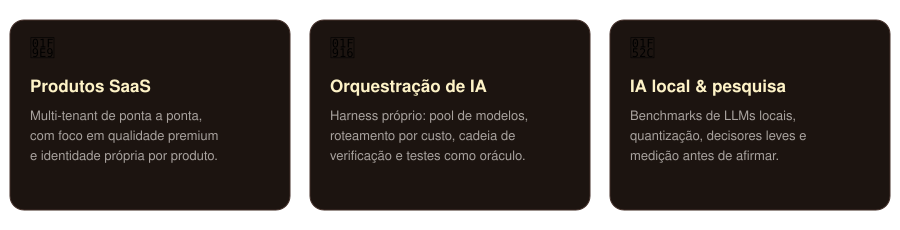
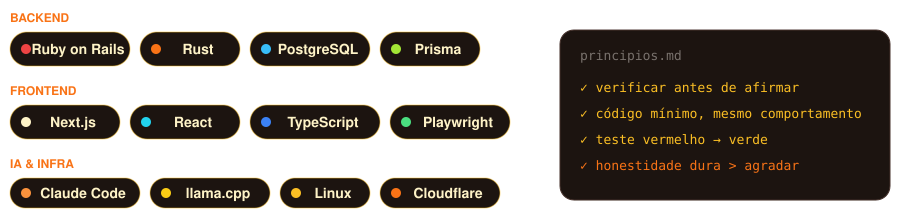

## 👋 Sobre

Construo **produtos SaaS premium** e uso IA como parte do time de engenharia. Gosto de decisão objetiva, evidência executável e produto com identidade própria.

## 🛠️ Stack

## 🚀 Em andamento

- **Helm** e **Anchor** — SaaS multi-tenant (Rails + Next.js)
- **Harness de agentes** — roteamento de modelos, cota e cadeia de verificação
- **IA local** — benchmarks de LLMs quantizados
- **Ferramentas em Rust** — monitores e utilitários de sistema

## 📫 Contato

<!-- troque pelos seus links -->

